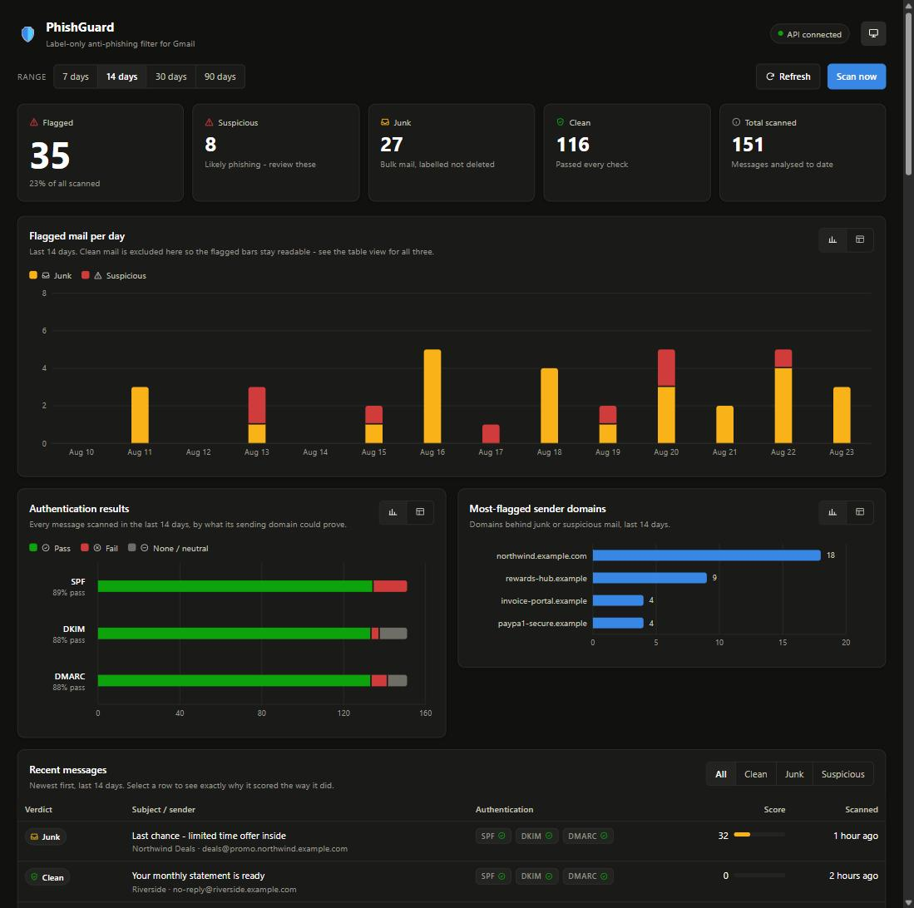
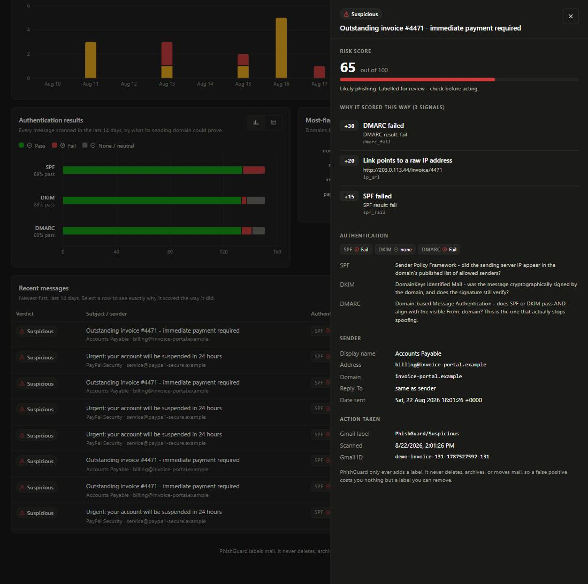

# PhishGuard

A self-hosted anti-phishing and junk-mail filter for personal Gmail, with a
Pi-hole-style threat dashboard.

PhishGuard polls your inbox over the Gmail API, scores each new message
against a set of explainable detection rules — email authentication, sender
spoofing, lookalike domains, link analysis, social-engineering language — and
applies a Gmail label to anything it flags. **It never deletes, archives, or
moves mail.** Every verdict comes with the full list of signals that produced
it.



Selecting any message shows exactly why it scored the way it did — every
signal, what it added, and the evidence behind it:



---

## Why it works this way

**Label, never delete.** The OAuth scope is `gmail.modify`, which grants
reading and label changes and *cannot* permanently delete mail. A false
positive costs you a label you can remove in one click — which is what makes
it safe to leave running and tune against real mail.

**Explainable, not a black box.** Every analyser returns weighted findings
with human-readable reasons, and they are stored with the message. "This is
phishing, confidence 0.87" is unfalsifiable; "DMARC failed (+30), the sender
domain impersonates paypal (+30), the link text says paypal.com but points at
paypa1-secure.example (+25)" is checkable in five seconds — and tells you
exactly which weight to change when it is wrong.

**Local first.** One SQLite file, one process, no outbound calls except to
Google's own API. Message bodies are analysed in memory and never stored.

---

## Quick start

Two paths — see **[docs/SETUP.md](docs/SETUP.md)** for the detail.

**Demo mode** (no Google account, ~5 minutes):

```bash
cd backend
python -m venv .venv && .venv/Scripts/Activate.ps1   # or: source .venv/bin/activate
pip install -r requirements.txt
cp .env.example .env
python -m app.tools.seed_demo --count 160 --days 21

cd ../frontend && npm install && npm run build

cd ../backend && uvicorn app.main:app --port 8000
```

Open **http://localhost:8000/**. The demo data is generated by running
synthetic messages through the real detection engine, so the scores and
findings are the ones the engine actually produces.

**Live Gmail** adds a one-time Google Cloud OAuth setup —
[docs/SETUP.md § Path B](docs/SETUP.md#path-b--live-gmail).

---

## What it detects

| Category | Signals |
|---|---|
| **Authentication** | DMARC failure (30), SPF failure (15), DKIM failure (15) |
| **Sender spoofing** | Brand name in display name the domain doesn't own (30), display name embedding a different address (20), Reply-To on another domain (15) |
| **Lookalike domains** | Sender typosquat (30), link typosquat (25) — homoglyph, typo, combo, and TLD-swap techniques |
| **Links** | Anchor text hiding a different destination (25), raw-IP links (20), shorteners (10) |
| **Language** | Credential requests (20), urgency and pressure (10) |
| **Bulk** | `List-Unsubscribe` / `List-Id` present (12) |

Weights sum to a 0–100 score. **≥ 50 → suspicious**, **≥ 25 → junk**,
otherwise **clean**. Thresholds are `.env` settings.

The weights are chosen so no single signal alone reaches `suspicious` — it
always takes a combination, because any individual heuristic has false
positives and combinations of them have far fewer.

Full reasoning for every weight, plus SPF/DKIM/DMARC explained from first
principles: **[docs/DETECTION.md](docs/DETECTION.md)**.

---

## Architecture

```
Gmail API → Poller → Analysis engine → SQLite → FastAPI → React dashboard
                   (explainable scoring)
```

- **`backend/`** — FastAPI service, Gmail client, detection engine, background
  poller, SQLite storage
- **`frontend/`** — Vite + React dashboard (Recharts)
- **`docs/`** — the documentation below

The detection engine is decoupled from Gmail: `analysis/eml.py` builds the
same internal message format from a raw `.eml` file, so the whole engine runs
offline with no OAuth at all.

```bash
python -m app.tools.scan_eml samples/phish_paypal.eml
python -m app.tools.scan_eml --domain paypa1-secure.com
```

---

## Documentation

| | |
|---|---|
| **[SETUP.md](docs/SETUP.md)** | Installation, OAuth, configuration, troubleshooting |
| **[ARCHITECTURE.md](docs/ARCHITECTURE.md)** | System design and the decisions behind it |
| **[BACKEND.md](docs/BACKEND.md)** | FastAPI, SQLAlchemy, Pydantic, uvicorn — what each does and why; file-by-file tour |
| **[DETECTION.md](docs/DETECTION.md)** | Email authentication explained, every signal and weight, tuning, limitations |
| **[FRONTEND.md](docs/FRONTEND.md)** | React, Vite, Recharts — what each does and why; design rules |

---

## Tests

```bash
cd backend && pytest -q     # 36 tests, ~1 second
```

Covers the scoring engine and each analyser, typosquat classification, `.eml`
parsing, every dashboard aggregate, and every API endpoint including its
failure modes. No test touches the network or a real mailbox.

---

## Limitations

PhishGuard catches **commodity phishing** — the mass-mailed lures that make up
almost everything reaching a personal inbox. It will not catch targeted
spear-phishing from a properly authenticated compromised account, and it does
not inspect attachments. It is a smoke detector, not a security guard.

The API has **no authentication** and is meant to bind to localhost. See
[docs/SETUP.md § A word on exposure](docs/SETUP.md#a-word-on-exposure).

Full discussion: [docs/DETECTION.md § Honest limitations](docs/DETECTION.md#part-5--honest-limitations).
